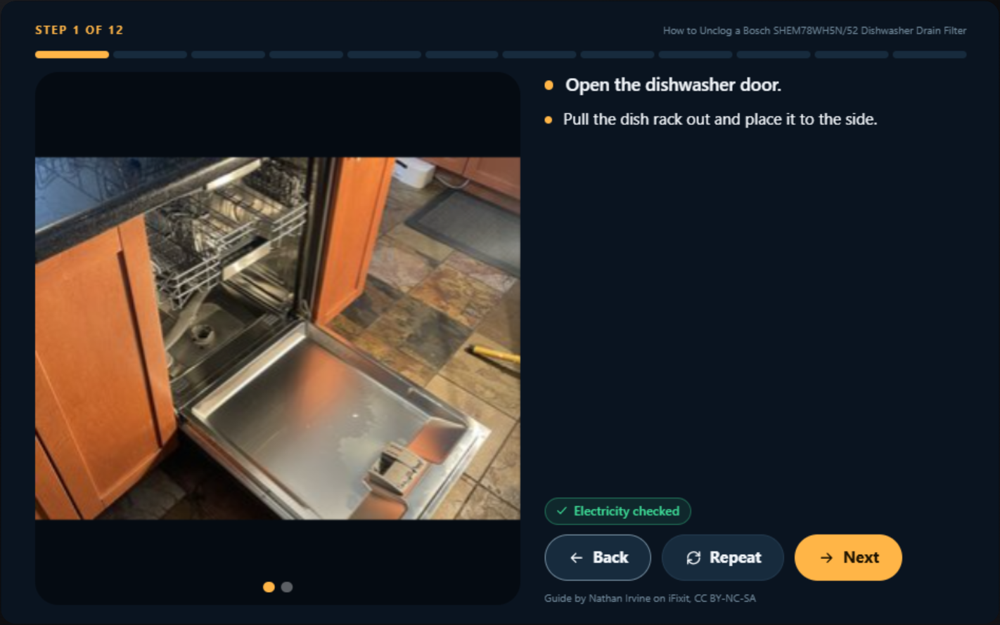

# Mend: hands-free repair for Alexa+

**"Alexa, my dishwasher won't drain."** Mend finds the right repair guide for *your* appliance. It walks you through it one step at a time, by voice, with the photo for each step on the Echo Show. Before every risky step it stops and asks *you*, not the AI, to confirm the power is off. Then it remembers the repair, your warranty and what maintenance is due next.

Mend is an **MCP server** implementing **MCP spec 2025-11-25 over Streamable HTTP**, built for the Alexa+ track. It ships with an **MCP Apps** screen for smart displays, **elicitation-based safety and purchase approval**, an **appliance passport** that persists across sessions, and an **Agent Skill**.



> Try it without hardware in **[Hearth](https://github.com/SMASH-Mash/hearth)**, the open-source Alexa+ / Echo Show simulator built alongside Mend.

## Why

- Homes throw out appliances and electronics that a $10 part or a 20-minute cleaning would have saved. The world generated a record **62 million tonnes of e-waste in 2022**, and only **22.3%** was documented as properly recycled. That's on track for **82 million tonnes by 2030** ([UN Global E-waste Monitor 2024](https://www.unitar.org/about/news-stories/press/global-e-waste-monitor-2024-electronic-waste-rising-five-times-faster-documented-e-waste-recycling)).
- Free, excellent repair guides already exist ([iFixit](https://www.ifixit.com) has tens of thousands). But you can't scroll a phone with wet, greasy hands halfway inside a dishwasher.
- A voice assistant with a screen is the right device for repair. It needs to be **safe**, **specific to your appliance**, and **remember what's in your home**.

## What it does

| You say | Mend does |
|---|---|
| "My dishwasher has water in the bottom" | Checks your **appliance passport** (Bosch SHEM78WH5N, under warranty), turns everyday words into repair terms ("drain filter", "drain pump") and finds matching **iFixit guides**. The exact-model match ranks first. |
| "Start the easy one" | Gives you the overview: difficulty, time, tools to fetch, and the risks it will check. |
| "Next" / "Repeat" / "Go back" | One step at a time: short spoken instructions, with the step photo, progress bar and cautions on screen. Touch works too. |
| *(before any step involving electricity, water, gas, a battery or refrigerant)* | **Asks you directly** through MCP elicitation: "Is the dishwasher switched off and unplugged?" It waits for your yes, which the AI can't give on your behalf. Refrigerant work stops with a referral to a technician. |
| "It works!" | Logs the repair, resets the maintenance clock ("clean the filter again in 30 days") and celebrates. |
| "It still doesn't drain" | Checks your warranty first ("your Bosch is covered until June 2027") and offers the guide's replacement part. |
| "Add the pump to my cart" | **Asks you to approve** the purchase (elicitation), then adds it to the cart (simulated in this prototype; links to the exact part search on Amazon). |
| "What maintenance is due?" | Tracks per-appliance tasks: dishwasher filter, fridge condenser coils, washer pump filter, dryer vent and more. |

## Built on MCP 2025-11-25

Mend uses the parts of the spec that a home voice assistant needs. The official TypeScript SDK (v2) negotiates `2025-11-25`, and the integration test asserts it.

| MCP feature | How Mend uses it |
|---|---|
| **Streamable HTTP with sessions** | A stateful `/mcp` endpoint, so the server can ask the person a question *in the middle of* a tool call. |
| **Elicitation (form mode)** | Safety confirmations and purchase approvals go straight to the person. The model can't approve on their behalf. |
| **Graceful degradation** | Clients without elicitation get a spoken "say yes when it's done" check instead of a silent skip (`confirmation_required`). |
| **MCP Apps** (`ui://mend/screen.html`) | One Echo Show screen for guides, step photos, safety, passport, cart and maintenance. It uses the official `@modelcontextprotocol/ext-apps` SDK, declares its CSP (iFixit image CDN only), calls tools on touch, and keeps the voice assistant in sync with `updateModelContext`. |
| **Structured content + speech-first text** | Every tool returns a 1–3 sentence spoken reply, then the same data serialized as JSON text (as the spec recommends, so any model sees ids like `guideId`), plus typed `structuredContent` for the screen. Step text is marked "read this exactly as written", so the assistant never improvises instructions. |
| **Server instructions** | They tell the assistant the workflow and voice style (one step at a time, never answer safety checks). |
| **Tool annotations** | `readOnlyHint` and `openWorldHint` mark safe lookups. |
| **Resources** | `mend://household/passport` (JSON) and the `ui://` screen. |
| **Prompts** | `fix_something(device, problem)`. |
| **Agent Skill** | [`skills/mend-repair/SKILL.md`](skills/mend-repair/SKILL.md) gives the workflow and voice rules in a portable form. |

### Tools

`find_repair_guides` · `start_repair` · `repair_step` · `finish_repair` · `add_part_to_cart` · `view_cart` · `register_appliance` · `appliance_passport` · `maintenance_due` · `mark_maintenance_done`

## Run it

Requires Node 20+.

```bash
npm install
npm start            # → MCP endpoint http://127.0.0.1:8787/mcp  (protocol 2025-11-25)
npm test             # unit tests + a full MCP session over HTTP
```

Then connect any MCP client:

- **Hearth** (voice + screen, like Alexa+ on an Echo Show): see [hearth](https://github.com/SMASH-Mash/hearth). Its default config already points at Mend.
- **MCP Inspector**: `npx @modelcontextprotocol/inspector`. Choose *Streamable HTTP* and enter `http://127.0.0.1:8787/mcp`.
- Any MCP Apps–capable client that can reach the URL renders the screen too.

| Environment variable | Default | |
|---|---|---|
| `PORT` / `HOST` | `8787` / `127.0.0.1` | Bind address. Host-header checks are on for loopback. |
| `MEND_DATA` | `data/households` | Where household JSON lives. |
| `MEND_OFFLINE=1` | off | Use the bundled guides only (no network). |
| `MEND_SEED=0` | seeds the demo home | The demo home has a Bosch dishwasher (in warranty), a Samsung fridge (coils overdue) and an LG washer. |
| `MEND_ALLOW_ANY_HOST=1` | off | Allow non-localhost Host headers (tunnels, hosting). |

Each household is separate: send `x-mend-household: <id>` (or `?household=`) on the session's first request.

## How it works

```
Alexa+ / Hearth ──(MCP 2025-11-25, Streamable HTTP)──► Mend
   ▲   │ voice + touch                                  ├─ iFixit API (guides, steps, photos, tools, parts)
   │   └─ MCP Apps screen (ui://mend/screen.html)       ├─ safety layer: hazard detection → elicitation
   └──── elicitation: "Is it unplugged?" ◄───────────────┤
                                                        └─ household store: passport, repairs, maintenance, cart
```

- **Safety layer** (`src/safety.js`): finds hazards in each step's text (electricity, water, gas, battery, refrigerant, heat, sharp, heavy). Mains-powered appliances always get a power check before step 1, even when the guide forgets. Each critical hazard is confirmed once per repair.
- **Search** (`src/ifixit.js`): iFixit's search doesn't understand "water at the bottom", so Mend maps symptoms to repair vocabulary, tries the most specific query first, and ranks by exact model, keywords, difficulty and photos. Guides are cached, and three are bundled for offline demos.
- **Passport** (`src/passport.js`): warranty math, maintenance schedules and matching "the fridge" to the right appliance.

## Data and attribution

Repair guides come from the [iFixit API](https://www.ifixit.com/api/2.0/doc). Guide content is © its authors and iFixit, licensed **CC BY-NC-SA**, and Mend shows the attribution on every step. This is a non-commercial hackathon prototype. Amazon cart actions are simulated; they create Amazon search links.

## Roadmap

- Native Alexa+ connection when third-party MCP servers can be added to Alexa+.
- Account linking (OAuth) for households, and real cart integration.
- Photo diagnosis: "show me the error code" through the Echo Show camera.
- Repair cafés and certified technicians when a fix isn't DIY.

## License

[MIT](LICENSE). Repair guide content belongs to its iFixit authors (CC BY-NC-SA).
